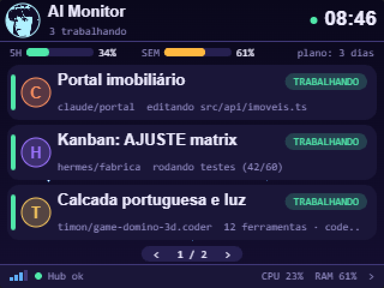
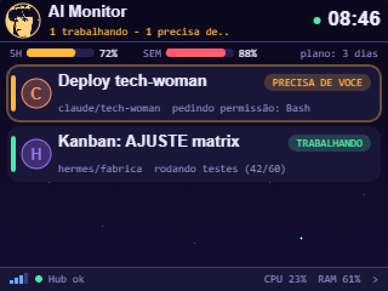
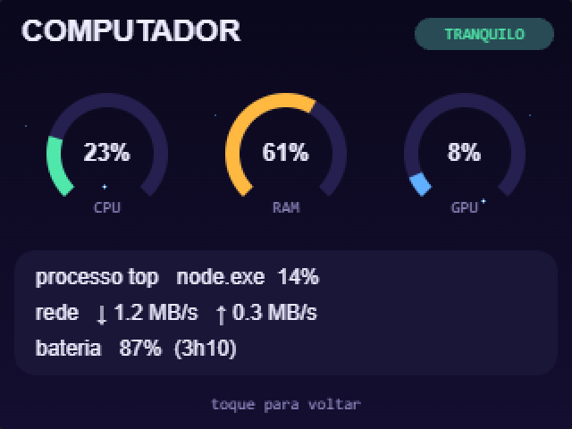
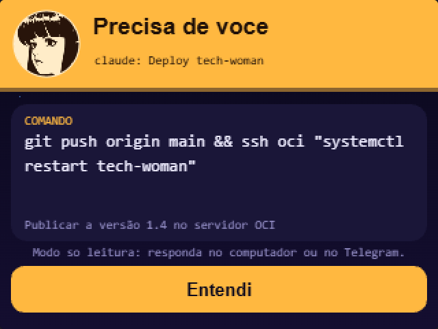
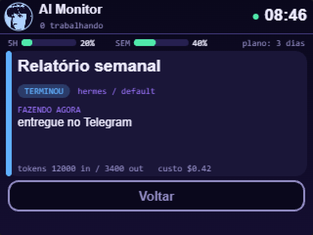
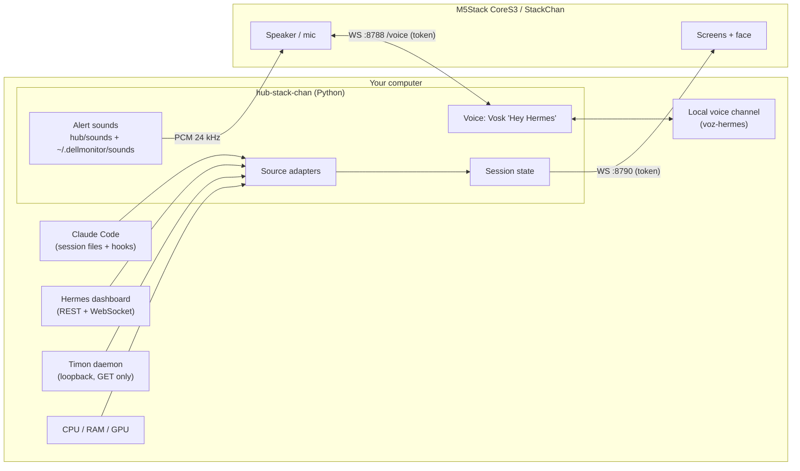

<div align="center">

# 🤖 AI Monitor

**A desk robot that watches your AI agents: live sessions, "needs you" alerts and a voice you can talk to — on an M5Stack CoreS3 / StackChan**

[](https://docs.m5stack.com/en/core/CoreS3)
[](https://platformio.org)
[](hub/README.md)
[](#-supported-sources)
[-00A67E.svg?style=flat)](#%EF%B8%8F-voice)
[](#-security--privacy-model)

*Stop switching windows to check whether an agent finished or is stuck waiting for you. The robot on your desk tells you — at a glance, with a sound, or out loud.*

[Português (README.pt-BR.md)](README.pt-BR.md)

</div>

---

## 📸 Screens

<div align="center">
  <table>
    <tr>
      <td align="center"><b>Live session list</b></td>
      <td align="center"><b>"Needs you" highlighted</b></td>
      <td align="center"><b>Idle face (Nous-Girl tribute)</b></td>
    </tr>
    <tr>
      <td align="center"></td>
      <td align="center"></td>
      <td align="center"></td>
    </tr>
    <tr>
      <td align="center"><b>Computer stats</b></td>
      <td align="center"><b>Permission request (read-only)</b></td>
      <td align="center"><b>Session detail</b></td>
    </tr>
    <tr>
      <td align="center"></td>
      <td align="center"></td>
      <td align="center"></td>
    </tr>
  </table>
  <sub>Rendered by the firmware simulator in <code>docs/preview.html</code> (sample data).</sub>
</div>

---

## ⚡ The Problem

Running several AI agents at once (Claude Code in a terminal, Hermes on Telegram and desktop, Timon on a board) means:
- An agent stops to **ask a question or a permission** and waits for twenty minutes because you didn't see it;
- You keep switching windows just to check **who finished** and who is still working;
- Usage limits and the machine's CPU/RAM are hidden in yet another tab.

---

## 💡 The Solution: AI Monitor

A small **Hub** runs on your computer, reads the agents locally and pushes a compact picture to the robot over your Wi-Fi. The robot answers three questions at a glance:

1. **What is running?** Up to 20 sessions, color-coded: working · **needs you** · finished.
2. **Does anyone need me?** Amber card and a spoken *"Preciso de você"* — repeated every minute (up to 5×) until you answer.
3. **Who just finished?** A spoken *"Terminei!"* and the card turns blue.

And when you want to ask something, just say **"Hey Hermes"**.

---

## 🚀 Key Features

- 🧭 **One screen for every agent:** Claude Code, Hermes (any origin: Telegram, desktop, CLI) and Timon in the same list, with the current tool or step of each session.
- 🔔 **Real attention signals:** Claude questions (`AskUserQuestion`), plan approvals (`ExitPlanMode`), permission prompts and Hermes `clarify` all become **needs you**.
- 🗣️ **Custom sounds without reflashing:** alerts are audio files played by the Hub. Ships with Portuguese voice clips and chimes; drop your own `finished.mp3` and it is used within 15 s. Built-in beeps remain as fallback.
- 🎙️ **Local voice assistant:** "Hey Hermes" is detected on the computer (Vosk, offline) and the conversation goes to a voice channel running on the same computer.
- 💻 **Computer screen:** CPU, RAM, GPU, network, top process and battery of the PC.
- 🛡️ **Read-only by default:** the robot shows approvals but cannot approve anything unless you explicitly enable it.
- 🔁 **Starts with Windows:** a supervisor brings the Hub (and the voice channel) back up at logon and whenever it crashes.
- 📶 **Friendly setup:** first boot opens an `AIMonitor-Setup` access point with QR code, network scan and live connection test.

---

## 🏗️ Architecture & Data Flow



- **Firmware:** C++ (Arduino on ESP32-S3) with M5Unified and PlatformIO, `default_16MB` partitions.
- **Hub:** Python 3.12, `websockets`, `aiohttp`, `psutil`, `vosk`, `av` (any audio format for alerts).
- **Protocol:** JSON over WebSocket, documented in [`firmware/PROTOCOL.md`](firmware/PROTOCOL.md).

---

## 📦 Getting Started

### 1. Flash the robot
```bash
cd firmware
pio run -t upload --upload-port COM5   # app + bootloader + partitions over USB
```
> ⚠️ This **replaces** the firmware currently on the robot. Back up the full flash first:
> `esptool --port COM5 read-flash 0 0x1000000 backup.bin`

### 2. Run the Hub on your computer
```bash
cd hub
python -m venv .venv && . .venv/Scripts/activate   # Linux/macOS: . .venv/bin/activate
pip install -r requirements.txt
cp config.example.yaml config.yaml                 # your settings stay out of git
python -m hub --config config.yaml
```
On first run the Hub prints a **pairing token**.

### 3. Connect the robot
The robot opens the `AIMonitor-Setup` network. Join it, open `http://192.168.4.1`, pick your Wi-Fi and enter the Hub IP (port **8790**) and the token. Without a Hub it runs a demo mode.

### 4. (Windows) Start with the system
`hub/windows/hub-stack-chan.ps1` keeps the Hub (and optionally the voice channel) running. Register it as a scheduled task at logon — see [`hub/README.md`](hub/README.md).

---

## 🔌 Supported Sources

| Source | How it is read | Working | Needs you | Finished |
|---|---|:---:|:---:|:---:|
| **Claude Code** | session files in `~/.claude/projects` + optional hooks (`hub/hooks/claude-hook.py`) | ✅ | ✅ questions, plans, permissions | ✅ |
| **Hermes** | dashboard REST + WebSocket with a fixed session token (`file:` path) | ✅ | ✅ `clarify` / approvals | ✅ any origin |
| **Timon** | local daemon, loopback only, GET only | ✅ | ✅ | ✅ |

Hermes voice, CLI one-shot, cron and ACP sessions do not play the "finished" sound, to avoid noise.

---

## 🎙️ Voice

| You | Robot |
|---|---|
| "Hey Hermes" | face switches to *listening* |
| ask anything | answers out loud through the local voice channel |
| tap while it speaks | stops talking |

Wake-word detection runs offline on the computer (Vosk `vosk-model-small-en-us`). The first conversation takes ~8–13 s to open; follow-ups within 5 min are immediate.

### Alert sounds

| File | Alert | Default |
|---|---|---|
| `needyou.*` | needs you | voice: *"Preciso de você."* |
| `finished.*` | finished | voice: *"Terminei!"* |
| `new.*` | new session | soft chime |

Defaults live in `hub/sounds/` (alternatives in `hub/sounds/opcoes/`, generator in `hub/sounds/gerar_sons.py`). Put a file with the same name in `~/.dellmonitor/sounds/` to override it — wav, mp3, ogg, m4a… Clips longer than 6 s are trimmed.

---

## 🔒 Security & Privacy Model

- **Read-only by default:** `allow_actions: false` — the robot displays approvals; you answer them on the computer.
- **Paired by token:** both device sockets (`:8790` monitor, `:8788` voice) reject clients without the Hub token.
- **Secrets never in YAML:** tokens are referenced as `file:~/.dellmonitor/...`; your `config.yaml` is git-ignored.
- **Local first:** the Hub talks to agents on loopback; the robot never talks to Claude, Hermes or any cloud API directly. Keep the Hub inside your LAN.
- **Hooks never block:** the Claude hook only reports status, never decides, and exits silently in ~2 s if the Hub is down.

---

## 🛠️ Building & Testing

```bash
# Hub test suite
cd hub
pip install -r requirements-dev.txt
python -m pytest -q

# Firmware build
cd firmware
pio run
```

`docs/preview.html` is a browser simulator of the firmware screens (regenerate with `firmware/tools/gen_preview.py`). Firmware details: [`firmware/README.md`](firmware/README.md) · Hub details: [`hub/README.md`](hub/README.md).

---

## 📄 License & Credits

- **License:** not defined yet — all rights reserved until a license file is added.
- The idle face is a **fan-made tribute to Nous Research's Nous-Girl**, not affiliated with Nous Research and not covered by any open license — see [`firmware/assets/nousgirl/TRIBUTE-README.md`](firmware/assets/nousgirl/TRIBUTE-README.md).
- The default spoken clips were synthesized with a Microsoft Edge neural voice; check its terms before redistributing them. The chimes are original.
- Concept inspired by desk AI monitors such as Miblo Desk; no code, art or branding was copied.
