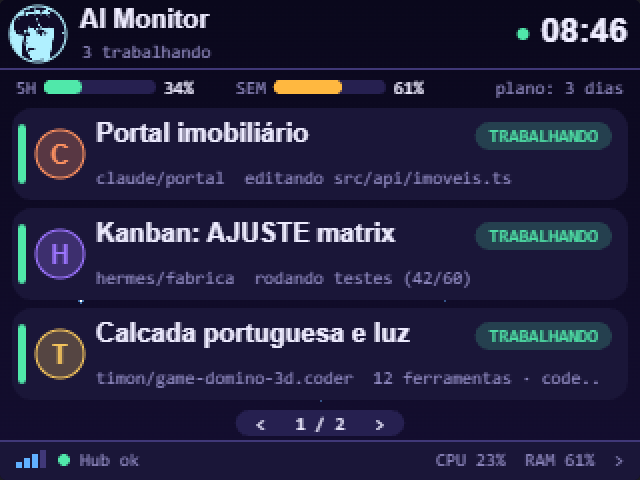
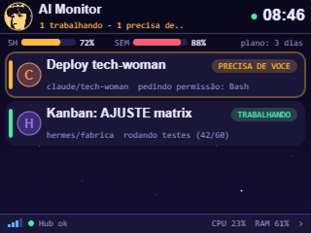
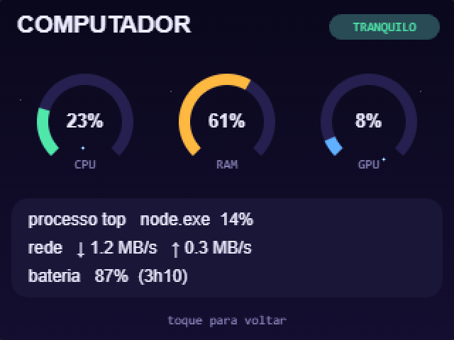
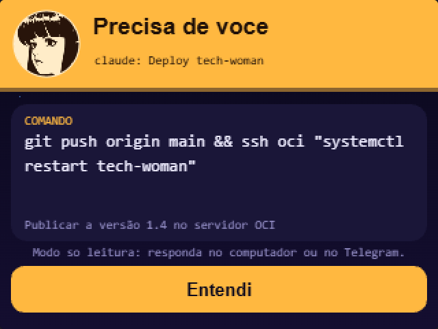
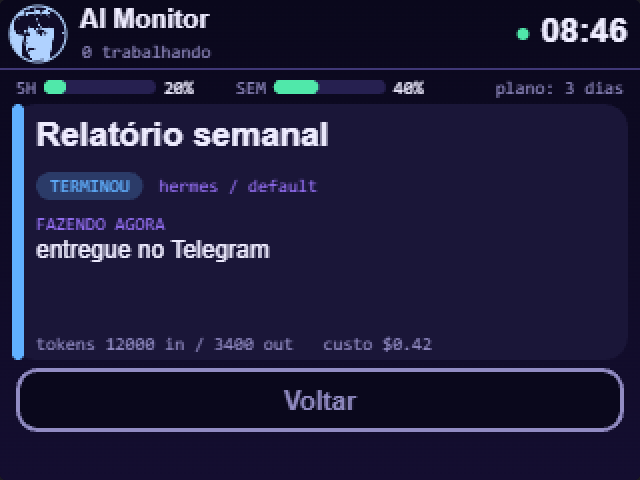
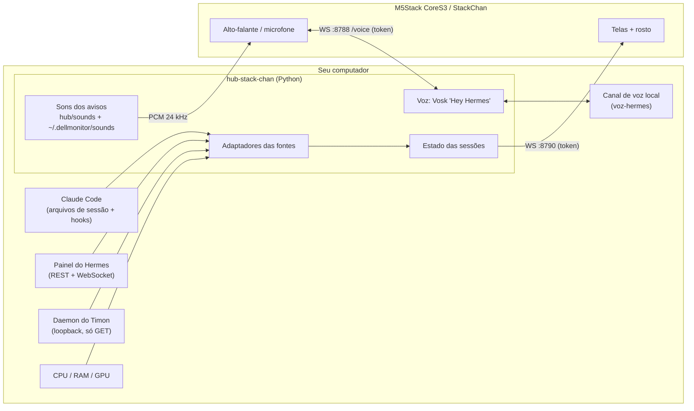

<div align="center">

# 🤖 AI Monitor

**Um robô de mesa que acompanha os seus agentes de IA: sessões ao vivo, aviso de "precisa de você" e uma voz para conversar — no M5Stack CoreS3 / StackChan**

[](https://docs.m5stack.com/en/core/CoreS3)
[](https://platformio.org)
[](hub/README.md)
[](#-fontes-suportadas)
[-00A67E.svg?style=flat)](#%EF%B8%8F-voz)
[](#-seguran%C3%A7a-e-privacidade)

*Pare de trocar de janela só para ver se um agente terminou ou está parado esperando você. O robô na sua mesa avisa — num olhar, com um som ou em voz alta.*

[English (README.md)](README.md)

</div>

---

## 📸 Telas

<div align="center">
  <table>
    <tr>
      <td align="center"><b>Lista de sessões ao vivo</b></td>
      <td align="center"><b>"Precisa de você" em destaque</b></td>
      <td align="center"><b>Rosto ocioso (tributo à Nous-Girl)</b></td>
    </tr>
    <tr>
      <td align="center"></td>
      <td align="center"></td>
      <td align="center"></td>
    </tr>
    <tr>
      <td align="center"><b>Estatísticas do computador</b></td>
      <td align="center"><b>Pedido de permissão (só leitura)</b></td>
      <td align="center"><b>Detalhe da sessão</b></td>
    </tr>
    <tr>
      <td align="center"></td>
      <td align="center"></td>
      <td align="center"></td>
    </tr>
  </table>
  <sub>Geradas pelo simulador do firmware em <code>docs/preview.html</code> (dados de exemplo).</sub>
</div>

---

## ⚡ O problema

Rodar vários agentes de IA ao mesmo tempo (Claude Code no terminal, Hermes no Telegram e no desktop, Timon num quadro) significa:
- Um agente para para **perguntar algo ou pedir permissão** e fica vinte minutos esperando porque você não viu;
- Você troca de janela o tempo todo só para conferir **quem terminou** e quem ainda está trabalhando;
- Limites de uso e CPU/RAM da máquina ficam escondidos em mais uma aba.

---

## 💡 A solução: AI Monitor

Um **Hub** pequeno roda no seu computador, lê os agentes localmente e manda um retrato compacto para o robô pelo Wi-Fi. O robô responde três perguntas num olhar:

1. **O que está rodando?** Até 20 sessões com cor por estado: trabalhando · **precisa de você** · terminou.
2. **Alguém precisa de mim?** Cartão âmbar e a voz dizendo *"Preciso de você"* — repetindo a cada minuto (até 5×) até você responder.
3. **Quem acabou de terminar?** A voz diz *"Terminei!"* e o cartão fica azul.

E quando quiser perguntar algo, é só dizer **"Hey Hermes"**.

---

## 🚀 Recursos principais

- 🧭 **Uma tela para todos os agentes:** Claude Code, Codex / ChatGPT, Orca, Hermes (qualquer origem: Telegram, desktop, CLI) e Timon na mesma lista, com a ferramenta ou etapa atual de cada sessão.
- 🔔 **Avisos que importam:** perguntas do Claude (`AskUserQuestion`), aprovação de plano (`ExitPlanMode`), pedidos de permissão e o `clarify` do Hermes viram **precisa de você**.
- 🗣️ **Sons personalizados sem regravar:** os avisos são arquivos de áudio tocados pelo Hub. Já vem com voz em português e sinos; coloque o seu `finished.mp3` e ele vale em até 15 s. Os bipes embutidos ficam de reserva.
- 🎙️ **Assistente de voz local:** o "Hey Hermes" é detectado no computador (Vosk, offline) e a conversa vai para um canal de voz rodando no mesmo computador.
- 💻 **Tela Computador:** CPU, RAM, GPU, rede, processo mais pesado e bateria do PC.
- 🛡️ **Só leitura por padrão:** o robô mostra as aprovações, mas não aprova nada a menos que você ative.
- 🔁 **Sobe com o Windows:** um supervisor religa o Hub (e o canal de voz) no login e sempre que ele cair.
- 🗣️ **Avisos falados por ferramenta:** "Claude terminou", "Hermes precisa de você", "ChatGPT começou"… (5 ferramentas × 3 avisos; sem o arquivo, usa o genérico).
- 🔊 **Volume no aparelho:** Configurações → − / + de 10 em 10 %, salvo na placa.
- 🧩 **Duas placas, um firmware:** M5Stack CoreS3 (StackChan) e LCDWiki ES3C28P 2,8" (`pio run -e es3c28p`).
- 🎬 **Modo demonstração:** `hub/tools/demo.py` roda um roteiro (sessões, decisão pendente, rostos, tela do computador) para gravar vídeo.
- 📶 **Configuração fácil:** na primeira vez o robô abre a rede `AIMonitor-Setup` com QR code, lista de redes e teste de conexão na hora.

---

## 🏗️ Arquitetura e fluxo de dados



- **Firmware:** C++ (Arduino no ESP32-S3) com M5Unified e PlatformIO, partições `default_16MB`.
- **Hub:** Python 3.12, `websockets`, `aiohttp`, `psutil`, `vosk`, `av` (qualquer formato de áudio nos avisos).
- **Protocolo:** JSON sobre WebSocket, documentado em [`firmware/PROTOCOL.md`](firmware/PROTOCOL.md).

---

## 📦 Como começar

### 1. Gravar o robô
```bash
cd firmware
pio run -t upload --upload-port COM5   # app + bootloader + partições pelo USB
```
> ⚠️ Isto **substitui** o firmware que está no robô. Faça antes o backup completo da flash:
> `esptool --port COM5 read-flash 0 0x1000000 backup.bin`

### 2. Rodar o Hub no computador
```bash
cd hub
python -m venv .venv && . .venv/Scripts/activate   # Linux/macOS: . .venv/bin/activate
pip install -r requirements.txt
cp config.example.yaml config.yaml                 # a sua configuração fica fora do git
python -m hub --config config.yaml
```
Na primeira execução o Hub mostra o **token de pareamento**.

### 3. Conectar o robô
O robô abre a rede `AIMonitor-Setup`. Conecte, abra `http://192.168.4.1`, escolha o seu Wi-Fi e informe o IP do Hub (porta **8790**) e o token. Sem Hub, ele roda em modo demonstração.

### 4. (Windows) Subir junto com o sistema
`hub/windows/hub-stack-chan.ps1` mantém o Hub (e, se quiser, o canal de voz) no ar. Registre como tarefa agendada no login — veja [`hub/README.md`](hub/README.md).

---

## 🔌 Fontes suportadas

| Fonte | Como é lida | Trabalhando | Precisa de você | Terminou |
|---|---|:---:|:---:|:---:|
| **Claude Code** | arquivos de sessão em `~/.claude/projects` + hooks opcionais (`hub/hooks/claude-hook.py`) | ✅ | ✅ perguntas, planos, permissões | ✅ |
| **Hermes** | REST + WebSocket do painel com token fixo (caminho `file:`) | ✅ | ✅ `clarify` / aprovações | ✅ qualquer origem |
| **Timon** | daemon local, só loopback, só GET | ✅ | ✅ | ✅ |
| **Codex / ChatGPT** | registros em `~/.codex/sessions` (só leitura; app, terminal e Orca) | ✅ | — | ✅ |
| **Orca** | sessões do Claude Code em `~/.orca` (ou `entrypoint: orca`) e sessões Codex do Orca | ✅ | ✅ | ✅ |

Sessões do Hermes de voz, linha de comando avulsa, cron e ACP não tocam o som de "terminou", para não fazer barulho à toa.

---

## 🎙️ Voz

| Você | Robô |
|---|---|
| "Hey Hermes" | o rosto muda para *ouvindo* |
| pergunta qualquer coisa | responde em voz alta pelo canal de voz local |
| toca na tela enquanto ela fala | para de falar |

A palavra de ativação é detectada offline no computador (Vosk `vosk-model-small-en-us`). A primeira conversa leva ~8–13 s para abrir; as seguintes, dentro de 5 min, são imediatas.

### Sons dos avisos

| Arquivo | Aviso | Padrão |
|---|---|---|
| `needyou.*` | precisa de você | voz: *"Preciso de você."* |
| `finished.*` | terminou | voz: *"Terminei!"* |
| `new.*` | sessão nova | sino suave |
| `<aviso>-<ferramenta>.*` | por ferramenta (`finished-claude.mp3`, `needyou-hermes.mp3`…) | voz: *"Claude terminou."* |

Os padrões ficam em `hub/sounds/` (alternativas em `hub/sounds/opcoes/`, gerador em `hub/sounds/gerar_sons.py`). Para usar outro, coloque um arquivo com o mesmo nome em `~/.dellmonitor/sounds/` — wav, mp3, ogg, m4a… Sons com mais de 6 s são cortados.

---

## 🔒 Segurança e privacidade

- **Só leitura por padrão:** `allow_actions: false` — o robô mostra as aprovações; você responde no computador.
- **Pareamento por token:** as duas portas do aparelho (`:8790` monitor, `:8788` voz) recusam quem não tem o token do Hub.
- **Segredos nunca no YAML:** tokens entram como `file:~/.dellmonitor/...`; o seu `config.yaml` fica fora do git.
- **Local primeiro:** o Hub fala com os agentes em loopback; o robô nunca fala direto com Claude, Hermes ou API na nuvem. Mantenha o Hub dentro da sua rede.
- **Hooks nunca travam:** o hook do Claude só informa o estado, nunca decide, e sai em silêncio em ~2 s se o Hub estiver fora.

---

## 🛠️ Compilar e testar

```bash
# Testes do Hub
cd hub
pip install -r requirements-dev.txt
python -m pytest -q

# Firmware
cd firmware
pio run
```

`docs/preview.html` é um simulador das telas do firmware no navegador (gerado por `firmware/tools/gen_preview.py`). Detalhes do firmware: [`firmware/README.md`](firmware/README.md) · do Hub: [`hub/README.md`](hub/README.md).

---

## 📄 Licença e créditos

- **Licença:** ainda não definida — todos os direitos reservados até um arquivo de licença ser adicionado.
- O rosto ocioso é um **tributo feito por fã à Nous-Girl, da Nous Research**, sem afiliação com a Nous Research e fora de qualquer licença aberta — veja [`firmware/assets/nousgirl/TRIBUTE-README.md`](firmware/assets/nousgirl/TRIBUTE-README.md).
- As falas padrão foram sintetizadas com uma voz neural do Microsoft Edge; confira os termos antes de redistribuí-las. Os sinos são originais.
- Conceito inspirado em monitores de IA de mesa como o Miblo Desk; nenhum código, arte ou marca foi copiado.
